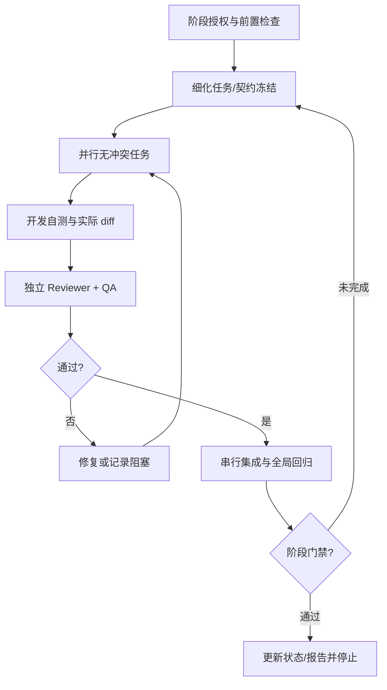

# 单窗口研发执行工作流（主 Agent）

## 1. 知识优先级

用户最新批准的范围/ADR → `docs/game_design.md` → 已批准的公共契约与依赖规则 → 模块 SDD → 本次任务的细化规格。代码与测试用于核对实现，不自动覆盖设计。冲突或重大未决项须记录 ADR 并等待批准；不得用下级文档静默改上级约束。研发执行规则以 AGENTS.md 与本页为准。

## 2. 阶段启动与分批

1. 收到明确阶段/批次目标，核对 [项目状态](../PROJECT_STATE.md)、真实 Git 分支、未提交变更、任务图、前阶段证据。只有用户授权的阶段可激活，前一阶段门禁须 DONE。2026-11-25 负责人单独授权 P3-CHR 在 P2 性能延期时先行，实际范围及状态见 [ADR-016](../docs/architecture/decisions/ADR-016-character-slice.md)。
2. 从 [工作包图](planning/task_graph.json) 选取前置满足的工作包，读取相关 SDD、需求与验收规格。必要时让 architect 查冲突、planner 细化任务。禁止从代码目录或自然语言协作依赖直接推断可并行性。
3. 每个 PACKAGE 必须先在 `planning/tasks/` 建立一个或多个 EXECUTION 任务 JSON，验证具体路径、需求、测试、前置、基线和验收；将子任务 ID 加入 `state/tasks.json`。父包只有在所有子任务集成、范围与验收证据满足后才 DONE。P0 已有可细化执行工作包；门禁由主 Agent 单独完成。
4. 共享契约/数据定义先由授权任务冻结，后续模块依赖冻结版。预留测试桩只用于独立测试，生产运行不得将 stub 当作正式能力。
5. 主 Agent 按 [所有权策略](planning/module_owners.json) 检查精确路径，登记任务锁与 Git worktree。选择最多 4 个子 Agent；若写入冲突或共享生成文件，分批/串行。启动请求给出角色、任务 ID、spec、上下文、工作目录、基线、测试和返回格式。不能为整个父模块无条件授予子目录权限。

## 3. 执行与验收循环

依次执行 [实现流程](workflows/development.md)、[审查流程](workflows/review.md)、[集成流程](workflows/integration.md) 和 [阶段验收](workflows/acceptance.md)。主 Agent 实际核对 diff、测试及集成证据，不能仅转述子 Agent 声称成功。修复尝试有明确预算；重复失败或权限/工具/硬件缺失进入 BLOCKED。任何真实测试不能跑，记录 NOT_RUN 和原因，不能冒充通过。

## 4. 状态机及共享状态

| 状态 | 进入条件 | 下一状态 |
|---|---|---|
| PLANNED | 已登记，尚未细化/授权 | READY、BLOCKED |
| READY | 已授权、前置 DONE、任务规格和路径审查通过、锁可用 | IN_PROGRESS、BLOCKED |
| IN_PROGRESS | 主 Agent 领取并登记工作区及基线 | TESTING、BLOCKED、PLANNED（取消回收） |
| TESTING | 实现候选存在，实际测试 | REVIEW、IN_PROGRESS、BLOCKED |
| REVIEW | 独立审查与 QA，证据完整 | INTEGRATING、IN_PROGRESS、BLOCKED |
| INTEGRATING | 独立审查通过，串行合并/回归 | DONE、IN_PROGRESS、BLOCKED |
| DONE | 合并结果、测试、审查与门禁证据齐全 | 主 Agent 发现回归可重开，记录原因 |
| BLOCKED | 具体前置、环境、冲突、审批或验证失败 | 修复后重新 PLANNED/READY |

只有主 Agent 持久化状态；状态文件一次完整替换并校验，避免多个 Agent 同时写。记录每次变更的 task ID、旧/新状态、时间、证据、原因、提交。任务级 DONE 不代表模块或需求已完成。模块状态 PARTIAL/IMPLEMENTED/VERIFIED 根据所有适用任务与需求证据推导，需求和测试 CSV 由主 Agent 更新。阶段可 PARTIAL/BLOCKED；完整阶段门禁通过后才 DONE。未执行的测试均保留 NOT_RUN。

## 5. 结束与恢复

每一批结束写 task report、stage report、更新状态/锁/阻塞、保存当前 commit 与未完任务；不自动开始下一阶段。不允许无限修复循环、强制删除未提交成果或覆盖用户修改。会话中断、模型/额度限制后按 [恢复流程](workflows/recovery.md) 重新核验，不依赖聊天记忆。

负责人另已单独提前放行 P4-GOV。只豁免该包与子任务对 GATE-P3 的依赖，其他阶段门禁仍适用。[范围与决策](../docs/architecture/decisions/ADR-017-governor.md)
