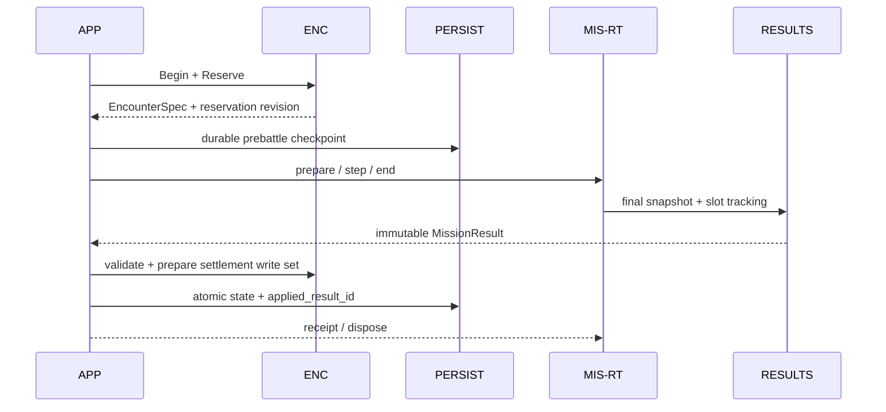
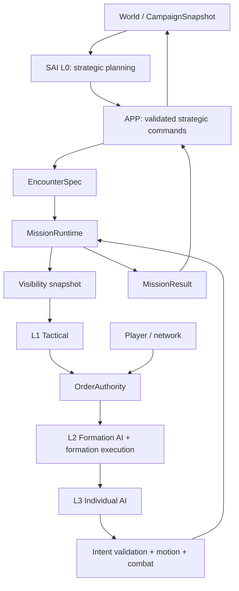

# 公共契约与实现边界

> 适用所有 SDD。基线： [总体规格书](../game_design.md) §3、§10、§12、§17–20。下文明确的是独立设计的补充约束，不修改上传原文。接口字段、枚举、目录新增、配置默认和技术版本需评审后冻结。涉及所有权、持久格式、网络版本的冲突先提交 ADR；不允许各 AI 自行选择不同解释。

项目负责人于 2026-11-24 批准 v1 的表示、时序、所有权及兼容规则。本文保留跨模块字段清单，签核的具体参数、版本及迁移政策见 [ADR-012](decisions/ADR-012-contract-freeze.md)，引擎、采样与回溯预算见 [ADR-011](decisions/ADR-011-technology-stack.md)。 本阶段新增的三类端口、MoveIntent 速度量化及存档物理提交见 [ADR-013](decisions/ADR-013-p1-ports-and-save.md)。

## 1. 类型与单位

| 类型 | 约定 | 约束 |
|---|---|---|
| `DefId` | `namespace:type/name` 字符串 | 稳定唯一，存档使用 ID，紧凑索引仅会话有效 |
| `HeroId`、`PartyId`、`ClanId`、`KingdomId`、`SettlementId`、`ArmyId` | 类型标签与小写规范 UUIDv4 字符串 | 不允许跨类型比较或重用 |
| `MissionId` / `TeamId` / `FormationId` | 任务作用域 | Team/Formation 与 MissionId 一起定位 |
| `AgentHandle` | `{index:uint32,generation:uint32}`，配套 MissionId | 索引重用必须增加 generation；过期返回 NotFound |
| `SourceSlotId` | Encounter 内稳定来源槽 | 每人形兵源只有一个槽，未生成也有终态；坐骑非兵源 |
| `GameMinute` | 非负整数 | 由 World/Clock 逐步推进，不等于 wall clock |
| `SimTick` | 非负整数 | 由 MissionRuntime 递增，模拟频率配置 |
| `Money` / `Influence` / `Count` | 最小单位整数（有界） | 余额非负，成本显式取整；中间计算检查溢出 |
| `WorldMapPos` | 地图定义的独立坐标类型 | 不可直接转为战场位置 |
| `Vec3` / `BattlePose` | 战场米、秒、弧度；右手 Y-up | 引擎轴与坐标变换由适配器处理；网络边界量化 |
| `Revision` | 每权威作用域单调增加 | 仅提交成功才增加；高频 tick 与业务 revision 区分 |
| `ContentHash` / `IntegrityHash` | 规范化数据的稳定摘要 | 按 ADR-012 的规范字节计算 SHA-256，认证另由信任链保证 |

`?` 表示字段可空，`[]` 表示有上限的序列；必须区分 None 与零。公共结构不可引用引擎 Node/RID、线程、函数或裸指针；v1 范围/编码/精度见 ADR-012。`Result<T>` 为 Ok(T) 或 Err(DomainError)，无隐式成功。

## 2. 权威命令、只读查询、事件与高频意图

```text
CommandEnvelope<C> { command_id, actor_ref, scope_id,
                     expected_revision?, issued_tick?, sequence?, payload:C }
CommandReceipt { command_id, status, committed_revision?, errors[], view_changes[] }
DomainError { code, message_key, field?, detail?, retryable }
QueryEnvelope<Q> { scope_id, visibility_context, payload:Q }
ReadModel<T> { scope_id, revision, tick?, content_hash, data:T }
EventEnvelope<E> { event_id, scope_id, revision, tick?, type, payload:E }
SnapshotStamp { scope_id, revision, tick?, nav_revision? }
ChangeSet { expected_versions[], operations[], invariant_checks[], committed_events[] }
IntentBatch { mission_id, source_tick, control_revision, inputs[] }
MoveIntent { actor_handle, desired_direction, speed_fraction, stance? }
LookIntent { actor_handle, yaw, pitch }
AttackIntent { actor_handle, input_phase, direction, weapon_slot, target_hint? }
BlockIntent { actor_handle, direction, held }
EquipIntent { actor_handle, slot, item_ref? }
InteractionIntent { actor_handle, target_ref, action }
```

`actor_ref` 从真实本地/联网授权上下文映射，不能信任客户端自报权限；`target_hint` 不是命中结果。`speed_fraction` 限幅；攻击阶段（开始、保持、释放、取消）由 COM 校验，方向为上/左/右/刺及武器允许子集。复用控制权、序号、版本校验。同 ID 同内容的已提交命令返回原回执；同 ID 不同内容 Conflict。频繁动作使用带 tick/generation 的批量意图，不写全局业务事件总线。

| 错误 | 场景 | 调用方处理 |
|---|---|---|
| InvalidArgument | 字段、类型、单位或范围不合法 | 修正输入，不自动重试 |
| Unauthorized | 身份、控制权、可见性、政治授权不足 | 显示原因，不绕过 |
| InsufficientResource | 钱、货、兵、容量不足 | 更新预览 |
| InvalidState | 当前阶段禁止操作 | 等待合法状态或取消 |
| StaleVersion | 报价、快照、控制权或导航版本过期 | 刷新后重新决策 |
| NotFound | ID/句柄无效、路径无可达目标 | 清除目标/替代流程 |
| Conflict | 重复 ID 内容不同、唯一性或预约冲突 | 停止冲突事务、诊断 |
| Unavailable | 服务、资源或适配器暂时不可用 | 可取消、退避重试或恢复 |

低频事件只能在事务提交后发布；每个事件带唯一 ID；关键一致性必须在同写集中完成，不依赖监听器顺序。后续命令进入下一合法阶段并有深度/数量预算。Query 不修改状态、不推进时间，不返回其他域私有可变引用。

## 3. 单写入与投影

| 权威事实 | 唯一写入模块 | 其他模块可见方式 |
|---|---|---|
| Session 状态、模式与流程 | APP | SessionView |
| 游戏分钟、地图位姿与路线 | WORLD（CAMP 聚合编排） | Party.pos 只读投影 |
| 英雄属性、成长、装备槽、生命 | CHR | 角色视图；库存移转经 INV 事务 |
| 家族成员、亲缘、职责、关系 | CLAN | Hero.clan_id 投影，政治资格查询 |
| 国家成员关系、决议、战争 | POL | Clan.kingdom_id 等事务投影 |
| 兵力、军团、俘虏、长期士气 | PARTY | 名册与可用量查询 |
| 货币、货物、唯一物品实例 | INV | 市场/队伍/领地库存引用 |
| 报价、需求、工坊、制造 | ECO | MarketView、Quote |
| 地点归属、治理、建设 | SET | 家族封地引用/投影，POL 授权 |
| 遭遇、战略围城、预留、提交去重 | ENC | EncounterSpec/Receipt |
| 任务阶段、对话/奖励状态 | QUEST | Journal、DialogueView |
| 战略 AI 计划 | SAI | 意图及诊断，不写业务实体 |
| Mission 生命期、Team、句柄、出生 | MIS-RT | 组件访问端口、只读快照 |
| 位置、速度、路径、通行版本 | MOV | MotionView、NavView |
| 动作、生命、装备、骑乘、个体战场士气 | COM | CombatView、DamageResult |
| 编队成员、命令、槽位、聚合士气 | FORM | FormationView、控制授权 |
| 战术/编队/个体决策状态 | BAI-T / BAI-F / BAI-I | Task/Intent/Feedback |
| 器械/城防临时状态 | SIEGE | SiegeChanges、NavLinkChange |
| 场景目标、回合、模式规则 | RULES | Objective/OutcomeView |
| 来源跟踪、结果构建 | RESULTS | MissionResult（只读） |
| 动态定义 | DEF overlay（由 ECO/INV 事务写） | DefinitionRegistry |
| 存档文件、提交标记、迁移链 | PERSIST | SaveReceipt/LoadSnapshot |
| 网络会话/连接/复制 | MP/NET（分别持有会话/协议状态） | 许可网络投影 |

本表为 §3.2 的细化：冗余字段只读或事务同步，禁止两个模块各自独立写入同一事实。角色位置/队伍成员、家族/王国归属、领地易主、装备实例、预留和结算必须经过 APP 跨域事务。`EntityStore` 负责组件容器，不意味着 MIS-RT 可以任意写各组件。

## 4. 战役/战场契约（保持 §17.4 字段）

```text
EncounterSpec {
  schema_version, encounter_id, reservation_revision, mode,
  scene_def_id, ruleset_id, environment, rng_seed,
  sides: [{ team_key, faction_id, commander_hero_id?, roster_allocations }],
  reserved_sources: [{ source_party_id, troop_def_id?, hero_id?, count,
                       source_slot_range, loadout_snapshot_id }],
  battle_limit, deployment_constraints, siege_snapshot?
}
MissionResult {
  schema_version, result_id, encounter_id?, mission_id, reservation_revision?,
  outcome, duration_ticks, winner_team_keys[], objective_results[],
  slot_outcomes: [{ source_slot_id, end_status, wounded, captor_team_key?, xp }],
  loot_claims[], hero_outcomes[], siege_changes?, reward_intents[], stats, integrity_hash
}
FormationOrder {
  mission_id, order_id, issuer_id, client_sequence, issued_tick,
  formation_ids[], order_type, target_position?, target_formation_id?, parameters
}
```

扩展提案：FormationOrder 的队列策略、完成条件、超时可进入 `parameters` 的版本化子 schema，避免无评审修改基础字段。`FormationTask`（L1→L2）和 `MemberConstraint`（L2→L3）仅 Mission 内短生命周期；若注册 MOD 扩展则版本化。槽位约束：每个 Encounter 的 reserved slot 集合和 MissionResult.slot_outcomes 集合完全相等（压缩区间展开后）；来源槽终态只有一个；英雄 count=1；未入场不得获得击杀/受击结果；撤离伤情另字段；俘虏候选在战役结算验证胜负和容量后确定。

`MissionResult` 的 end_status 枚举候选为 alive/wounded/dead/captured/withdrawn/not_spawned，失能与死亡的最终归类必须采用 ENC 规则，不能由动画或未授权客户端决定；若进入战役前需要暂定伤亡，使用独立观测字段及结算规则版本，不修改最终结果的唯一来源语义。结果哈希用于损坏检测，赛果真实性另需认证服务端。

P2 野战在各 Side.roster_allocations 中列出半开来源区间。准备阶段校验跨队唯一、完整覆盖和范围合法；v1 通用读取仍兼容历史训练。[ADR-014](decisions/ADR-014-field-source-teams.md)

## 5. 跨模块关键时序



在事务提交标记成功之前不暴露最终奖励；提交后回执丢失返回去重回执。自定义/多人 ResultRouter 禁止访问战役写端口。交易同理：Quote → 版本检查 → 资源写集 → 原子 commit → GoodsTraded。任何写入失败不留下部分状态。

## 6. 调度与数据流



战略时间相位见 §4.2；Mission 固定 tick 顺序见 §10.4。L1/L2/L3 可错峰，读取上一已提交状态或同 tick 明确的阶段产物，不允许任意读写对方中间态；玩家命令优先、撤销委派使授权版本失效。工作线程只读快照，输出带 scope、tick、generation、order/nav revision；过期结果丢弃或重算。权威提交按稳定排序。视觉/音效/日志丢弃不影响真值。

## 7. 版本、配置、性能与未决项

- 存档 schema、内容 API、网络协议、原生 ABI 分别版本化；兼容策略按已批准的 ADR-012 执行，迁移与测试同提交。
- 原规格数值作为初始目标：500 人默认、1000 压力，60/30 Hz、战略计划 1–6 游戏小时、战术 0.5–2 Hz、编队 2–5 Hz、个体 5–20 Hz；不是实测结果。配置必须声明单位、范围、默认、来源、难度作用及是否可 MOD 覆盖。
- P0 采用已签核的 ADR-011 与 ADR-012。性能范围含 500/1000 名活跃人形、蒙皮、动态通行和 headless 专服；正式资产扩量时按 GDD 复验。
- 玩法未穷举的原创新参数（各技能树、兵种树、战术权重、地图场景、经济需求、任务文本、船舶参数、视觉骨骼）由相应 SDD 后续数据表和内容评审冻结。不要把拟定数值或目录误认为已实现。


P3 人物沿用同一命令信封、持久化回执与世界内容摘要。可选的 v1 人物子仓库、模块所有权及旧世界处理见 [ADR-016](decisions/ADR-016-character-slice.md)。

P4 总督的受信命令、SET 所有权、只读资格及可选 v1 快照见 [ADR-017](decisions/ADR-017-governor.md)。

P5 庄署会面沿用同一会话与存档，任务权威、锁定的实结账簿及经验收据见 [ADR-018](decisions/ADR-018-estate-visit.md)。
