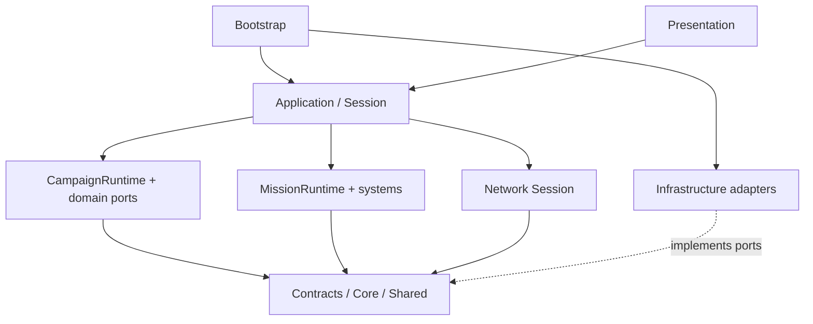

# 模块依赖、装配与研发顺序

## 1. 静态依赖白名单（按目录边界，设计提案）

下表是代码 import 边界；各 SDD 的“协作边界”列是运行时读/写端口和用例协作关系，并不是允许直接 import 对方私有实现的依赖图。避免把运行时相互查询误解为循环静态引用。

| 调用方 | 允许的静态依赖 | 禁止 |
|---|---|---|
| contracts | 语言基础库、稳定值类型 | 引擎、任何业务域 |
| core | contracts、语言基础库 | campaign/mission/UI/引擎场景 |
| shared/definitions | contracts | 运行时实体、基础设施实现 |
| shared/inventory、shared/rules | contracts、core、definitions | campaign、mission 私有实现 |
| campaign | contracts、core、shared、本域公开端口 | mission、presentation、infrastructure 私有实现 |
| mission | contracts、core、shared、本域公开端口 | campaign、presentation、infrastructure 私有实现 |
| application | contracts、core、campaign/mission public facade、会话端口 | 引擎场景、业务私有仓库 |
| infrastructure | contracts、core、被实现的端口、SDK | 反向控制业务真值、任意访问领域对象 |
| presentation | contracts、application/MP public ports、表现适配端口 | 直接写领域对象 |
| multiplayer | contracts、core、application/mission public facade、网络/身份端口 | campaign 私有状态、客户端真值 |
| bootstrap | 所需公开模块、适配器 | 业务逻辑实现、持久世界单例 |
| addons / 扩展 | 公开注册 API、稳定 contracts、适配端口 | 反射改核心、私有类依赖 |
| server / tools / native | 对应公开 API、批量数据契约 | 复制一套业务真值 |

本域模块之间的协作必须通过局部 ports 或 public facade。若 A 需要 B 的查询、B 又需要 A 的写命令，则查询接口由消费者定义/注入，写命令由应用层编排；不能互相 import 实现。具体语言的静态检查器待 P0 冻结。

## 2. 组合根与调用链



运行时 APP 创建各作用域，BOOT 装配工厂；公共契约无可变全局服务。专服用同一装配根的 headless profile，核心域不依赖场景树。

## 3. 开发顺序（不缩减最终功能）

| 阶段 | 主要文档与前置 | 门禁 |
|---|---|---|
| P0 | CON、CORE、INF-ENGINE、NATIVE、COM、MOV、NET、TEST/CI 风险实验 | 冻结引擎/语言/版本、真实 500/1000 人/骨骼/动态导航/专服报告；ADR |
| P1 | BOOT、APP、DEF、SHRULE、INV、CAMP、MIS-RT、PERSIST、INF-CONTENT、TELEM | 可启动、纯领域测试、内容编译与初始存档迁移 |
| P2 | COM、MOV、FORM、BAI/BAI-T/BAI-F/BAI-I、RULES、RESULTS、INPUT/CAM/VIS/AUD | 野战与动作/指挥、部署增援及性能门禁 |
| P3 | WORLD、CHR、CLAN、PARTY、ENC、基础 UI | 角色、名册、世界与战场结算；AT-01/05/09/10 |
| P4 | ECO、SET、POL、SAI 四类 planner、SIEGE | 经济政治、战略围城与攻城；AT-02/03/06/08/14 |
| P5 | QUEST、INTERACT、RULES 其余模式、UI、BASE | 剧情、沙盒、访问/竞技/潜入、自定义、主流程 UX |
| P6 | NET、MP、SERVER-D/L/OPS、ADDONS、TOOLS | 专服、匹配、多人所有模式、MOD、编辑器、安全 |
| P7 | BASE 全量内容、TOOLS、TEST、CI、发布 | 所有 MUST 需求通过、内容/授权/安装升级验收 |
| P8 | NAVAL-C/M/P | 独立 EXT，不影响本体，AT-17 |

每阶段可并行的工作须先冻结接口契约；存档、联网与 MOD 公共边界在 P0/P1 即定义，不等到最终阶段才改造。阶段只是依赖顺序，不将任何 MUST 功能降级为可选。

## 4. AI 实现任务模板

```yaml
id: impl-FORM-001
module: FORM
spec: docs/systems/game/mission/formation/README.md
requirements: [BAI-01]
allowed_paths: [game/mission/formation/, game/tests/]
prerequisite: [CON, CORE, MIS-RT]
contract_changes: none
acceptance_tests: [T-FORM-01]
status: planned
```

先读总体基线、公共契约、模块 SDD 和实际代码；如果前置缺失、契约冲突或需新增目录，提交 ADR/问题单，不私自实现第二套接口。实现代码、配置、测试和证据；审查后更新需求/任务追踪。以上 YAML 为模板，不是已经创建的实际执行任务或可运行 CI。

## 5. 模块路径与规格路径同步

任务中的 `spec` 应与 [模块注册表](module_registry.json) 的 `doc` 一致；`allowed_paths` 使用经批准的代码目录（可参考 `code_paths`，不能因此自动扩大修改权限）。子目录按镜像 README 定位上级权威 SDD。目录变化必须同步 [目录映射](directory_map.md)、需求追踪与用例文档路径，不改原有 import 白名单或阶段依赖语义。

## 6. 研发任务依赖（执行版 0.3）

本页的依赖是静态 import 和协作端口规则；开发工作包 DAG 见 [task_graph.json](../../development/planning/task_graph.json)。工作包只在前置任务与阶段授权满足后细化为可执行任务。跨域 AT 测试若需后续模块，不得在早期假定已经通过；参见 [阶段计划](../../development/planning/roadmap.md)。

父目录与子模块写权限可能重叠，必须使用 [所有权策略](../../development/planning/module_owners.json) 与实际任务排除路径。模块注册表不直接等于编辑许可。任务级权限、状态机、审查与集成以 [工作流](../../development/workflow.md) 为准。
